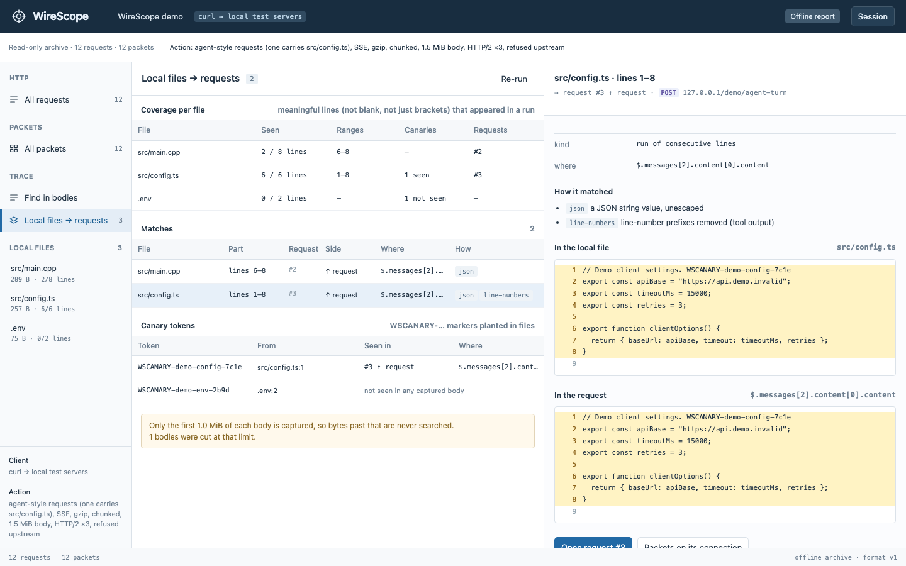

# WireScope

**Follow one HTTP request all the way down to the bytes on the wire.**

WireScope is a traffic inspector I'm building in C++17. You pick a request the proxy recorded, and from there you can keep going down: the TCP connection it used, the IP packets that made up that connection, and the exact byte offset of every header field.

**[Try the demo in your browser →](https://andy-fiddler.vercel.app)** No install needed. It's an offline report with local test data. The site can't see your own traffic; WireScope does that on your machine.


## Why this exists

This summer I interned on a data-loss-prevention PoC. The question was simple to ask and annoying to answer: when someone uploads a file to an AI service, what actually goes over the network? To find out, I wrote a TLS-intercepting proxy from scratch in C++. I started from raw Winsock and worked my way up to HTTP/2. That work lives in a separate repo, `local-proxy-lab`.

Watching real traffic taught me more than reading docs did. I uploaded the same file to three services, and they used three different upload protocols:
- claude.ai sent plain `multipart/form-data`.
- Gemini used Google's resumable upload protocol.
- ChatGPT did a single `PUT` to Azure Blob storage.

Both resumable uploads and Blob storage can split a file into chunks, but neither did for any file I tested. A protocol supporting something doesn't mean the client uses it.

On my last day, my mentor said roughly: "You've seen the flow in Fiddler. Next, build the inspector yourself." This repo is that. The name started as "Andy's fiddler" and the tool grew into WireScope.

## The idea: cross-layer

Most network tools live on one layer.

- **Fiddler** shows requests and responses really well, but not the packets they rode on.
- **Wireshark** shows every packet and every header. The HTTP inside TLS is ciphertext unless you have the session keys.

I wanted to click a request and keep going down:

```
 L7  HTTP    POST /v1/messages · headers · body · HTTP/2 stream 5    <- recorded in plaintext by the proxy
              │
              │  connection key  127.0.0.1:53211 | 127.0.0.1:18080
              ▼
 L4  TCP     one connection · SYN → … → FIN · seq/ack · byte stream per direction (gaps stay gaps)
              │
              ▼
 L3  IP      the packets that carried it · src/dst · TTL · length
              │
              ▼
 L2  bytes   02 02 02 … 08 00 45 00 …    click a field, see its bytes (and the other way round)
```

|  | Fiddler | Wireshark | WireScope |
|---|---|---|---|
| Main layer | L7 | L2–L7, packet by packet | L7 down to L2, linked |
| HTTPS content | decrypted via its own CA | decrypted if you have a key log | decrypted via a local CA |
| Request → packets | not shown | packets shown, not tied to requests | jump via the connection |
| Field → bytes | n/a | yes | yes |

One thing to be clear about: requests and packets are linked **through the TCP connection**. A single connection can carry many requests (keep-alive, HTTP/2 multiplexing). So the answer is "these are the packets of the connection this request used", not a one-to-one match. The UI says that too.

A note on the word: in networking research, *cross-layer design* usually means letting layers share information to optimize performance. A wireless link exposing channel quality to the transport layer is the classic example. Here I only mean looking across layers while you analyze. Different goal, same instinct: don't let the layer boundaries hide what's going on.

## One layer above L7: your own files

The question from the internship was never really "what does this request contain". It was "what happened to *my file*". So the latest addition starts one step earlier: register the files of an experiment repository, and WireScope finds which part of each file ended up in which request.



Here, lines 1–8 of `src/config.ts` were inside request #3, in `$.messages[2].content[0].content`. They only match after two steps that are listed with the match: the JSON string is unescaped, and the line numbers a file-reading tool adds (`     1→`) are stripped. The fake `.env` canary appears nowhere.

How it matches, in short:
- **Canaries.** Plant a random `WSCANARY-…` token in each file. If it shows up in a request, there's no other place those bytes could have come from.
- **Runs of lines.** Consecutive file lines that appear as consecutive lines of a body, after undoing gzip, JSON escaping, SSE framing, base64 and multipart. Lines like `}` or `return;` can't start a match on their own, since every file has them.
- **Bytes** for binary files (the whole file, or the longest prefix of an upload cut short), and long lines quoted inside other text.
- One match per body and file range, at the most specific location.

What it proves is narrow on purpose: *these bytes were inside this captured request*. It doesn't say which process read the file, and "not seen" only means not seen in what the proxy captured. Both sentences are on the screen next to the results. The details are in [docs/PROVENANCE.md](docs/PROVENANCE.md), and [experiments/001-agent-file-egress](experiments/001-agent-file-egress) has a kit for running the same task through several coding agents: a sandbox repo with canaries, a runner that records one agent, and a fake agent with a known ground truth to check the whole thing.

## What it can and can't see

| | |
|---|---|
| **Full content** | HTTP/1.x and HTTP/2: method, headers (in original order), bodies, streams, trailers, timing. HTTPS too, if the client trusts the local CA |
| **Structure and bytes** | TCP, UDP, ICMP, ARP and IPv4/IPv6 header fields; DNS queries; TLS record types; pass-through TLS tunnels; WebSocket traffic after the upgrade; anything from apps that ignore proxy settings |
| **Your files in requests** | Which lines (or bytes) of a registered local file were inside which captured body, and which planted canaries never showed up |
| **Not visible** | QUIC/HTTP3 payloads, apps that pin certificates, the meaning of non-HTTP protocols, which process *read* a file, content that was summarized or rewritten before it left, the sending process outside Windows |

The full breakdown is in [docs/COVERAGE.md](docs/COVERAGE.md) (in Korean for now). It covers what needs special setup, storage limits, and why each blind spot exists.

## A quick tour

**Fields ↔ bytes.** Click a field and its bytes light up. Here it's `TCP flags` at offset 47. Click a byte and you get the narrowest field that contains it.


**Comparing two requests.** You get a JSON diff by leaf path, plus a side-by-side line diff. If you tell it to ignore a path or sort keys, it says so at the top of the diff instead of quietly hiding it.


<sub>The screenshots use real requests sent with curl through WireScope to local test servers (HTTP/1.1, HTTPS, HTTP/2), plus a synthetic pcap. None of it is real AI-service traffic.</sub>

## Features

- **Proxy** on `127.0.0.1:18080`. It handles HTTP/1.x and CONNECT, and decrypts HTTPS with a local CA that issues per-host certificates on the fly. The proxy still verifies the real server's certificate on the other side.
- **HTTP/2**: two nghttp2 sessions bridged stream by stream. Chunked bodies and trailers are kept, and WebSocket upgrades are tunneled. There's also a pass-through mode that relays TLS without decrypting it.
- **Packets**: live capture through Npcap with BPF filters, or import from pcap/pcapng. It decodes Ethernet up through DNS and TLS records, keeps byte offsets for every field, and previews each TCP stream with gaps marked.
- **Inspector UI** on `127.0.0.1:17890`. For each request you get headers, the body (JSON, text, hex, SSE events, chat-style `messages`), a timeline, and the packets on the same connection. gzip/deflate decoding is a toggle.
- **Trace**: *Find in bodies* searches every body after decoding, and *Local files → requests* traces registered files into requests, with coverage per file and a side-by-side view of the file lines and the request lines. The same code (`web/provenance.js`) runs in the UI, in offline reports and in a CLI (`scripts/provenance_cli.mjs`).
- **Notes and comparisons**: structural JSON diff, plus session metadata (which client, what you did) and per-request notes, so experiments stay reproducible.
- **Export** to a `.wscope` session, `.pcapng`, or a single-file HTML report. The report carries the viewer with it, so it works offline, and it has an optional pattern-based redaction mode.
- **The local API isn't left wide open**: per-run token, Host check (DNS rebinding), Origin check (cross-site requests), CSP.
- **Windows only**: each request shows which process opened the proxy connection (PID, exe, command line, parent), read from the Windows TCP table the moment the connection is accepted. An opt-in **Use as system proxy** switch points WinINET at the proxy and puts your old setting back afterwards. Details in [docs/WINDOWS.md](docs/WINDOWS.md).

### Rules I try to stick to

- **Show the data, not a verdict.** No banners like "this looks like a file upload". Headers, bytes, timing and connections, then you decide.
- **Say what's missing.** A truncated body shows `captured / total`. Bytes the capture never saw show up as `GAP n bytes`, never filled in.
- **Don't hide normalization.** If a diff ignores some paths, it tells you which ones and how many.

## Build and run

You need CMake ≥ 3.20, a C++17 compiler, OpenSSL 3 and nghttp2. Live capture on Windows needs [Npcap](https://npcap.com/) installed with loopback support.

```powershell
# Windows: Visual Studio 2022+ with "Desktop development with C++" (brings MSVC, CMake and vcpkg)
.\scripts\build-windows.ps1 -Test all      # vcpkg builds OpenSSL + nghttp2 once, then build and run the tests
.\build-windows\Release\WireScope.exe
```

```sh
# macOS with Homebrew
cmake -S . -B build -DCMAKE_PREFIX_PATH="/opt/homebrew/opt/openssl;/opt/homebrew/opt/libnghttp2"
cmake --build build -j
ctest --test-dir build --output-on-failure   # unit + end-to-end + lab
./build/WireScope --sample                   # starts with synthetic data → http://127.0.0.1:17890
```

Options: `--port N` (UI port), `--data DIR` (where the CA lives; `%LOCALAPPDATA%\WireScope` on Windows), `--web DIR`, `--no-open`, `--sample`, `--body-limit MiB` (bytes kept per body direction, 1 by default, up to 32).

To point a client at the proxy (proxy env vars, `NODE_EXTRA_CA_CERTS`, curl `--cacert`), open **Certificate → Client setup** in the UI. WireScope only changes the Windows system proxy when you press **Use as system proxy**: it saves the old setting first and restores it when you turn it off, stop the proxy or quit. CLI tools such as curl and Node.js-based agents ignore that setting anyway, so they need the environment variables.

## Where it stands

Windows is the real target. It builds with MSVC and the whole test suite runs on a GitHub Actions Windows runner. Nobody has run it on a Windows desktop yet.

| | |
|---|---|
| macOS dev host: build, unit tests (128 assertions), end-to-end tests (58 assertions against local HTTP, HTTPS and HTTP/2 servers), provenance tests in node (71), experiment-kit dry run with a fake agent (14), lab v1–v11 smoke tests (94) | passing, 2026-10-16 |
| Windows runner (Server 2025, MSVC `/W4` with 0 warnings): the same unit, end-to-end and lab tests, plus 35 Windows-only checks (process attribution against real PIDs, system proxy on/off/crash recovery, Korean `--data` path) | passing, 2026-10-16 — see [docs/WINDOWS.md](docs/WINDOWS.md) |
| UI driven in headless Chrome: list, detail, SSE, gzip, compare, packet hex, offline report, process column, find in bodies, local files → requests, adding and removing files | no JS errors |
| Npcap live capture, Windows certificate store install, a real Windows 10/11 desktop | **not verified yet** |
| Real AI services and coding agents | **not done yet**. The kit for it is ready ([experiment 001](experiments/001-agent-file-egress)) |

## Finding your way around

| Doc | What's in it |
|---|---|
| [docs/COVERAGE.md](docs/COVERAGE.md) | What it sees, what needs setup, what it can't see, what's verified |
| [docs/PROVENANCE.md](docs/PROVENANCE.md) | How local files are traced into requests, and what that does and doesn't prove |
| [experiments/001-agent-file-egress](experiments/001-agent-file-egress) | Protocol and scripts for comparing coding agents |
| [docs/lab/README.md](docs/lab/README.md) | The lab roadmap and per-version notes |
| [docs/AI-HANDOFF.md](docs/AI-HANDOFF.md) | Context, design decisions, what's left |
| [docs/OPEN-SOURCE-REFERENCES.md](docs/OPEN-SOURCE-REFERENCES.md) | Projects I looked at vs. libraries I actually use |

Most docs are in Korean for now.

If you want to read the code, this order works:

1. `src/core.hpp` / `core.cpp`: the data model (Flow, Packet, Store), sessions, reports
2. `src/proxy.cpp`: HTTP/1, CONNECT, TLS termination
3. `src/http2.cpp`: relaying streams between the client-side and upstream nghttp2 sessions
4. `src/packet.cpp`, `src/capture.cpp`: packet decoding and Npcap capture
5. `src/main.cpp`: the local API and its security checks
6. `web/app.js`: the inspector UI, shared by live mode and offline reports
7. `web/provenance.js`: decoding bodies into views and matching local files against them
8. `tests/`: `core_tests.cpp`, `integration_test.py`, `provenance_test.mjs`, `experiment_dryrun_test.py`, `lab_smoke.py`

Built with C++17, OpenSSL, nghttp2, libpcap/Npcap, cpp-httplib, nlohmann/json, plain JavaScript (no framework), and CMake/CTest; node and Python for tests and scripts.
