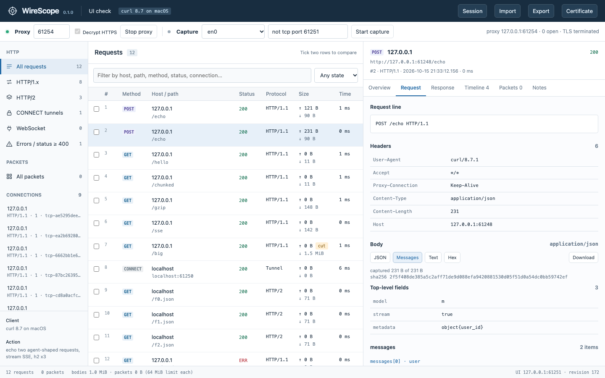
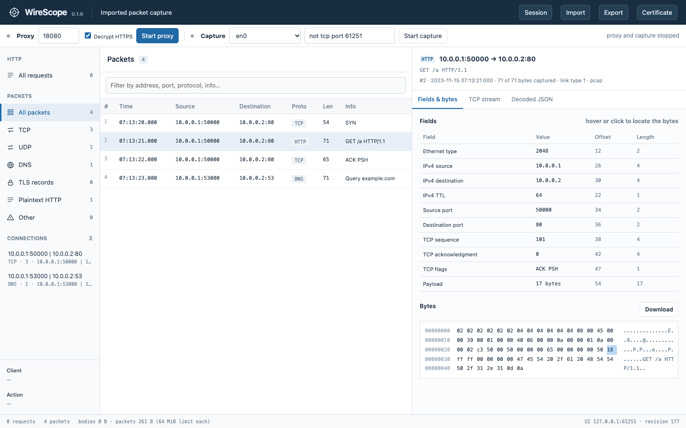
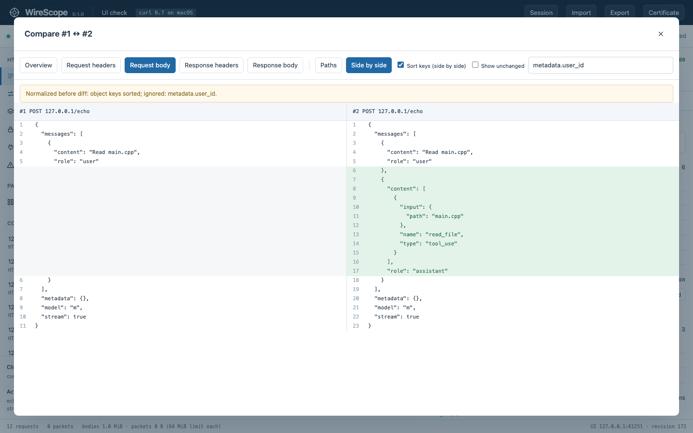

# WireScope

**Follow one HTTP request all the way down to the bytes on the wire.**

WireScope is a traffic inspector I'm building in C++17. You pick a request the proxy recorded, and from there you can keep going down: the TCP connection it used, the IP packets that made up that connection, and the exact byte offset of every header field.



## Why this exists

This summer I interned on a data-loss-prevention PoC. The question was simple to ask and annoying to answer: when someone uploads a file to an AI service, what actually goes over the network? To find out, I wrote a TLS-intercepting proxy from scratch in C++. I started from raw Winsock and worked my way up to HTTP/2. That work lives in a separate repo, `local-proxy-lab`.

Watching real traffic taught me more than reading docs did. I uploaded the same file to three services, and they used three different upload protocols:
- claude.ai sent plain `multipart/form-data`.
- Gemini used Google's resumable upload protocol.
- ChatGPT did a single `PUT` to Azure Blob storage.

Both resumable uploads and Blob storage can split a file into chunks, but neither did for any file I tested. A protocol supporting something doesn't mean the client uses it.

On my last day, my mentor said roughly: "You've seen the flow in Fiddler. Next, build the inspector yourself." This repo is that. The name started as "Andy's fiddler" and the tool grew into WireScope.

## The idea: cross-layer

Most network tools live on one layer.

- **Fiddler** shows requests and responses really well, but not the packets they rode on.
- **Wireshark** shows every packet and every header. The HTTP inside TLS is ciphertext unless you have the session keys.

I wanted to click a request and keep going down:

```
 L7  HTTP    POST /v1/messages · headers · body · HTTP/2 stream 5    <- recorded in plaintext by the proxy
              │
              │  connection key  127.0.0.1:53211 | 127.0.0.1:18080
              ▼
 L4  TCP     one connection · SYN → … → FIN · seq/ack · byte stream per direction (gaps stay gaps)
              │
              ▼
 L3  IP      the packets that carried it · src/dst · TTL · length
              │
              ▼
 L2  bytes   02 02 02 … 08 00 45 00 …    click a field, see its bytes (and the other way round)
```

|  | Fiddler | Wireshark | WireScope |
|---|---|---|---|
| Main layer | L7 | L2–L7, packet by packet | L7 down to L2, linked |
| HTTPS content | decrypted via its own CA | decrypted if you have a key log | decrypted via a local CA |
| Request → packets | not shown | packets shown, not tied to requests | jump via the connection |
| Field → bytes | n/a | yes | yes |

One thing to be clear about: requests and packets are linked **through the TCP connection**. A single connection can carry many requests (keep-alive, HTTP/2 multiplexing). So the answer is "these are the packets of the connection this request used", not a one-to-one match. The UI says that too.

A note on the word: in networking research, *cross-layer design* usually means letting layers share information to optimize performance. A wireless link exposing channel quality to the transport layer is the classic example. Here I only mean looking across layers while you analyze. Different goal, same instinct: don't let the layer boundaries hide what's going on.

## What it can and can't see

| | |
|---|---|
| **Full content** | HTTP/1.x and HTTP/2: method, headers (in original order), bodies, streams, trailers, timing. HTTPS too, if the client trusts the local CA |
| **Structure and bytes** | TCP, UDP, ICMP, ARP and IPv4/IPv6 header fields; DNS queries; TLS record types; pass-through TLS tunnels; WebSocket traffic after the upgrade; anything from apps that ignore proxy settings |
| **Not visible** | QUIC/HTTP3 payloads, apps that pin certificates, the meaning of non-HTTP protocols, which process sent the traffic, local file I/O |

The full breakdown is in [docs/COVERAGE.md](docs/COVERAGE.md) (in Korean for now). It covers what needs special setup, storage limits, and why each blind spot exists.

## A quick tour

**Fields ↔ bytes.** Click a field and its bytes light up. Here it's `TCP flags` at offset 47. Click a byte and you get the narrowest field that contains it.



**Comparing two requests.** You get a JSON diff by leaf path, plus a side-by-side line diff. If you tell it to ignore a path or sort keys, it says so at the top of the diff instead of quietly hiding it.



<sub>The screenshots use real requests sent with curl through WireScope to local test servers (HTTP/1.1, HTTPS, HTTP/2), plus a synthetic pcap. None of it is real AI-service traffic.</sub>

## Features

- **Proxy** on `127.0.0.1:18080`. It handles HTTP/1.x and CONNECT, and decrypts HTTPS with a local CA that issues per-host certificates on the fly. The proxy still verifies the real server's certificate on the other side.
- **HTTP/2**: two nghttp2 sessions bridged stream by stream. Chunked bodies and trailers are kept, and WebSocket upgrades are tunneled. There's also a pass-through mode that relays TLS without decrypting it.
- **Packets**: live capture through Npcap with BPF filters, or import from pcap/pcapng. It decodes Ethernet up through DNS and TLS records, keeps byte offsets for every field, and previews each TCP stream with gaps marked.
- **Inspector UI** on `127.0.0.1:17890`. For each request you get headers, the body (JSON, text, hex, SSE events, chat-style `messages`), a timeline, and the packets on the same connection. gzip/deflate decoding is a toggle.
- **Notes and comparisons**: structural JSON diff, plus session metadata (which client, what you did) and per-request notes, so experiments stay reproducible.
- **Export** to a `.wscope` session, `.pcapng`, or a single-file HTML report. The report carries the viewer with it, so it works offline, and it has an optional pattern-based redaction mode.
- **The local API isn't left wide open**: per-run token, Host check (DNS rebinding), Origin check (cross-site requests), CSP.

### Rules I try to stick to

- **Show the data, not a verdict.** No banners like "this looks like a file upload". Headers, bytes, timing and connections, then you decide.
- **Say what's missing.** A truncated body shows `captured / total`. Bytes the capture never saw show up as `GAP n bytes`, never filled in.
- **Don't hide normalization.** If a diff ignores some paths, it tells you which ones and how many.

## Build and run

You need CMake ≥ 3.20, a C++17 compiler, OpenSSL 3 and nghttp2. Live capture on Windows needs [Npcap](https://npcap.com/) installed with loopback support.

```sh
# macOS with Homebrew
cmake -S . -B build -DCMAKE_PREFIX_PATH="/opt/homebrew/opt/openssl;/opt/homebrew/opt/libnghttp2"
cmake --build build -j
ctest --test-dir build --output-on-failure   # unit + end-to-end + lab
./build/WireScope --sample                   # starts with synthetic data → http://127.0.0.1:17890
```

Options: `--port N` (UI port), `--data DIR` (where the CA lives; `%LOCALAPPDATA%\WireScope` on Windows), `--web DIR`, `--no-open`, `--sample`.

To point a client at the proxy (proxy env vars, `NODE_EXTRA_CA_CERTS`, curl `--cacert`), open **Certificate → Client setup** in the UI. WireScope never touches your system proxy settings.

## Where it stands

Windows is the real target, and it still hasn't been compiled there. Everything below was checked on my Mac.

| | |
|---|---|
| Build, unit tests (94 assertions), end-to-end tests (46 assertions against local HTTP, HTTPS and HTTP/2 servers) | passing, 2026-10-15 |
| lab v1–v8 smoke tests (86 assertions) | passing. v6 live capture only checked on its error path, since this Mac has no BPF permission |
| UI driven in headless Chrome: list, detail, SSE, gzip, compare, packet hex, offline report | no JS errors |
| Windows build, Npcap live capture, Windows certificate store | **not verified yet** |
| Real AI services and coding agents | **not done yet**. That's the next experiment |

## lab/

Before (and next to) the main tool, I broke each idea out into its own small program. That's how I learn. The code comments and notes in `lab/` are in Korean.

| Inside the proxy | On the wire | Showing it |
|---|---|---|
| v1 what to record, and body limits | v4 packets → fields and offsets | v7 engine ↔ browser, and what to lock down |
| v2 TLS pass-through vs. termination | v5 packets → TCP byte stream, gaps | v8 structural diff, standalone HTML |
| v3 HTTP/2 frames and HPACK | v6 libpcap/Npcap and BPF | |

The roadmap, and which part of `src/` each one maps to, is in [docs/lab/README.md](docs/lab/README.md).

## Finding your way around

| Doc | What's in it |
|---|---|
| [docs/COVERAGE.md](docs/COVERAGE.md) | What it sees, what needs setup, what it can't see, what's verified |
| [docs/lab/README.md](docs/lab/README.md) | The lab roadmap and per-version notes |
| [docs/AI-HANDOFF.md](docs/AI-HANDOFF.md) | Context, design decisions, what's left |
| [docs/OPEN-SOURCE-REFERENCES.md](docs/OPEN-SOURCE-REFERENCES.md) | Projects I looked at vs. libraries I actually use |

Most docs are in Korean for now.

If you want to read the code, this order works:

1. `src/core.hpp` / `core.cpp`: the data model (Flow, Packet, Store), sessions, reports
2. `src/proxy.cpp`: HTTP/1, CONNECT, TLS termination
3. `src/http2.cpp`: relaying streams between the client-side and upstream nghttp2 sessions
4. `src/packet.cpp`, `src/capture.cpp`: packet decoding and Npcap capture
5. `src/main.cpp`: the local API and its security checks
6. `web/app.js`: the inspector UI, shared by live mode and offline reports
7. `tests/`: `core_tests.cpp`, `integration_test.py`, `lab_smoke.py`

Built with C++17, OpenSSL, nghttp2, libpcap/Npcap, cpp-httplib, nlohmann/json, plain JavaScript (no framework), and CMake/CTest.
